<!-- stream-to-shorts by Akshat96af. Copyright (c) 2026 Akshat96af. All rights reserved. See LICENSE. -->
<p align="center">
  
</p>

<p align="center">
  <a href="https://github.com/Akshat96af/stream-to-shorts/stargazers"></a>
  <a href="https://github.com/Akshat96af/stream-to-shorts/network/members"></a>
  <a href="https://github.com/Akshat96af/stream-to-shorts/commits"></a>
  <a href="LICENSE"></a>
</p>

<p align="center">
  
  
  
  
  
  
  
  
</p>

> [!WARNING]
> **Official source only.** stream-to-shorts is published only at [github.com/Akshat96af/stream-to-shorts](https://github.com/Akshat96af/stream-to-shorts) by **Akshat96af**.
> Re-uploads, renamed copies and paid bundles are unauthorised, unreviewed and may be modified. Install from this repository.

<p align="center"><a href="#-install">Jump to install ↓</a></p>

# stream-to-shorts⁠​‌​​​​​‌​‌‌​‌​‌‌​‌‌‌​​‌‌​‌‌​‌​​​​‌‌​​​​‌​‌‌‌​‌​​​​‌‌‌​​‌​​‌‌​‌‌​​‌‌​​​​‌​‌‌​​‌‌​⁠

Your agent can already cut video. **stream-to-shorts gives it the judgment of a professional clipper**: it learns
what you want, finds the moments viewers actually rewatched, writes a hook for the first frame, edits the Short with
captions, music and effects, checks every frame, and hands you upload-ready videos with titles and hashtags.

```text
ask -> find the moment -> check it like an editor -> render -> quality check -> deliver -> learn from the views
```

You install it once. From then on, one sentence does the whole job: *"make 6 Shorts from this stream"*.

> Pick the moment a stranger can't scroll past. Everything else is automated.

| Included | Count | What it gives you |
|---|--:|---|
| Moment finders | 5 | Most-replayed graph, chat replay, live chat spikes, voice + webcam reactions, live audio spikes |
| Layouts | 3 | Facecam on top, full width, centre crop: at 1080p, 1440p or 4K, 30 or 60 fps |
| Caption styles | 3 × 6 colours | Word-pop, clean, or none; upper or normal case; low or middle position |
| Lessons learned | 34 | Real mistakes from a working clipping channel, turned into rules the agent follows |
| Agent briefs | 3 | Editor, uploader and analyst roles for multi-agent runs |
| Safety tools | 4 | Content filter, 8-frame QC sheet, segment blur, privacy scanner |
| Optional extras | 2 | Live dashboard (play, delete, restore) and a YouTube Studio uploader with safety rules |

<p align="center">
  <a href="https://www.star-history.com/#Akshat96af/stream-to-shorts&Date">
    <picture>
      <source media="(prefers-color-scheme: dark)" srcset="https://api.star-history.com/svg?repos=Akshat96af/stream-to-shorts&type=Date&theme=dark" />
      
    </picture>
  </a>
</p>

## 📦 Install

One command, no cloning:

```bash
npx skills add Akshat96af/stream-to-shorts
```

Then start a new session in your agent and say what you want. On its first run the skill checks your PC (ffmpeg,
Python and the speech model) and tells you exactly what, if anything, is missing.

| Where you use it | How to install |
|---|---|
| **Claude Code / Claude Desktop** | `npx skills add Akshat96af/stream-to-shorts` |
| **claude.ai and other chat apps** (no install, plans clips from transcripts) | download [`stream-to-shorts-web.zip`](stream-to-shorts-web.zip) and upload it in your skill settings |
| **Manual** | download the latest release and unzip it into your agent's skills folder |

> [!TIP]
> Install it once per agent. Installing the same skill twice in one agent creates duplicates; installing it in two
> different agents is fine.

## ▶️ Start using it

You talk; the skill does the rest. The first time, it asks a few quick questions about your channel, the clips you
want, your caption style and quality, then remembers the answers.

| What you want | Say this |
|---|---|
| Shorts from a finished stream | *"Make 6 Shorts from this stream: &lt;link&gt;"* |
| Shorts from your own recording | *"Clip the funniest moments from D:/streams/friday.mp4"* |
| A Short every 20 minutes from a live stream | *"Watch &lt;channel&gt; live and give me a Short every 20 minutes"* |
| Better hooks and titles | *"My Shorts get no views, rewrite the hooks and titles"* |
| Shorts in 4K | *"Render these in 4K at 60 fps"* |
| Watch the work live | *"Open the dashboard"* |
| Post them for you | *"Upload them to my channel, private, max 5 a day"* |

<table>
<tr>
<td width="40%" align="center"></td>
<td width="60%">

### What every Short gets

- **Hook on frame 1**: written from what is seen and said, never generic
- **Word-pop captions** that follow the voice, filtered for misheard lyrics and repeats
- **Facecam on top, gameplay below** whenever the streamer is on camera
- **Beat drop on the payoff**: your music starts so its drop lands on the moment
- **Punch-in, shake, flash and SFX** on the peak; voice first, music ducked under it
- **Automatic QC** (loudness, peaks, black frames, silence) plus an 8-frame check sheet
- **Title, description and 12-15 hashtags** that credit the source creator

</td>
</tr>
</table>

## ⚡ How it works

<p align="center"></p>

<details>
<summary><strong>The five steps in detail</strong></summary>

| | Step | What happens |
|:-:|---|---|
| 1 | **Asks first** | Learns your channel, platform, the clips you want, captions, quality and pace, or picks them up from the chat. |
| 2 | **Finds the moments** | Ranks what viewers rewatched (most-replayed graph), chat explosions, and real voice + face reactions. |
| 3 | **Checks like an editor** | Looks at the frames and reads the transcript: premise, payoff, a real reaction, nothing unsafe, nothing repeated. |
| 4 | **Renders** | At the size your PC and source allow, with hook, captions, layout, music, SFX and effects, then runs QC. |
| 5 | **Delivers** | Hands you the Shorts and an upload kit, or uploads them for you if you opt in. |
</details>

<details>
<summary><strong>Layouts</strong></summary>

<p align="center"></p>
</details>

<details>
<summary><strong>Settings you can change by just asking</strong></summary>

| Setting | Options | Default |
|---|---|---|
| Output size | 1080p · 1440p · 4K (2160x3840) | 1080p |
| Frame rate / length | 60 · 30 fps / 20-60 s | 60 fps / 45 s |
| Quality | high · balanced · fast | balanced |
| Captions | pop · clean · none; 6 colours; upper/normal; low/middle | pop, yellow, upper, low |
| Content filter | strict · standard · off | strict |
| Music / SFX | your own licensed audio, or voice only | voice only until you add audio |
| Uploads (optional) | private / public, daily cap | private, 10 |
</details>

## 🏆 Why choose stream-to-shorts?

| Without it | With stream-to-shorts |
|---|---|
| Clips picked by loudness, full of cutscenes and menus | Moments viewers **rewatched**, with a real reaction and a payoff |
| Generic "you won't believe this" hooks | A hook written per clip from what is **seen and said** |
| Captions that quote song lyrics or loop words | Lyrics and loops filtered, captions checked before render |
| The same mistakes on every new channel | **34 lessons** from a real clipping channel, applied every time |
| Fixed 1080p | 1080p to **4K**, matched to your PC and source |
| Files uploaded to someone's cloud | **100 % local**: nothing leaves your PC |
| No idea why a Short flopped | Views and retention compared per hook, layout and length |

## 📁 What's inside

```text
stream-to-shorts/
|-- SKILL.md                  # the workflow your agent follows
|-- references/               # rules, 34 lessons learned, intake questions, agent briefs, troubleshooting
|-- scripts/                  # moment finders, renderer, QC, dashboard, privacy scanner, optional uploader
|-- assets/                   # artwork and the bring-your-own-audio guide
|-- stream-to-shorts-web.zip  # no-install edition for chat apps
|-- config.example.json       # every setting with its default
```

<details>
<summary><strong>Annotated scripts</strong></summary>

```text
scripts/
|-- vod.py            # finished streams: most-replayed graph + chat replay + loudness -> top moments at 1080p+
|-- scan.py           # fast ranking of a long recording (about 90 s per 2 h), nothing cut until you choose
|-- moments.py        # voice + webcam-motion moments in a recording, cut and transcribed
|-- clipwatcher.py    # records a live stream and cuts on chat spikes
|-- audiowatch.py     # live streams without readable chat: cuts on loud reactions
|-- cut.py            # one moment from any file or timestamp
|-- finalize.py       # the renderer: layout, captions, hook, music, SFX, effects, QC
|-- blur_segment.py   # rescue a good clip by blurring one stretch
|-- music.py          # starts each track so its drop lands on the moment
|-- check_setup.py    # first-run check of ffmpeg, Python and models
|-- privacy_scan.py   # finds personal data before you share a folder
|-- dash.py, status.* # optional local dashboard
|-- uploader/         # optional YouTube Studio uploader
```
</details>

## 🔒 Security and privacy

- Runs **entirely on your computer**. No accounts, no telemetry, nothing uploaded unless you turn the uploader on.
- The dashboard listens on `127.0.0.1` only; the uploader uses your own signed-in browser and never handles passwords.
- `privacy_scan.py` checks any folder for e-mails, channel ids, keys and names before you share it.
- Report a vulnerability privately: see [SECURITY.md](SECURITY.md).

## ❓ FAQ

<details><summary><b>Does it need a GPU, a paid API or a powerful PC?</b></summary>

No. It runs on a normal PC with free tools and scales with your hardware: 1080p on a laptop, 1440p or 4K on a stronger
machine. An Intel or NVIDIA encoder makes rendering faster.
</details>

<details><summary><b>Which agents does it work with?</b></summary>

Claude Code and Claude Desktop get the full edition. claude.ai and other chat apps use the web edition, which plans
clips from transcripts and timestamps without installing anything.
</details>

<details><summary><b>Does it upload by itself?</b></summary>

Only if you ask. By default you get the Shorts plus a ready-to-paste upload kit. The optional uploader is private by
default, respects a daily cap, waits for the platform's checks and never clicks "publish anyway".
</details>

<details><summary><b>Can I clip any streamer?</b></summary>

Clip creators who allow it and always credit them. The skill keeps a list of creator rules and puts the credit and
source link in every description.
</details>

<details><summary><b>Is music included?</b></summary>

No. Add your own licensed tracks and sound effects; Shorts also work with the streamer's voice only.
</details>

<details><summary><b>Something went wrong</b></summary>

Tell your agent what happened; the skill carries a troubleshooting guide. Or open an
[issue](https://github.com/Akshat96af/stream-to-shorts/issues/new/choose).
</details>

## 🧭 Background

stream-to-shorts was built by **Akshat96af** while running a real clipping channel: live streams recorded, moments
cut, Shorts edited and posted around the clock. Every rule in it, from "never quote song lyrics as speech" to "wait
for the platform's checks before publishing", comes from a mistake made once and never repeated.

Release notes: [CHANGELOG.md](CHANGELOG.md).

## 📜 License

**Copyright (c) 2026 Akshat96af. All rights reserved.** Free to use for your own videos, including monetised
channels. You may not sell, re-upload, rebrand or publish modified copies of this skill. See [LICENSE](LICENSE).

<p align="center"><b>If stream-to-shorts saves you hours, star the repo ⭐</b><br/><sub>Made by <b>Akshat96af</b></sub></p>
