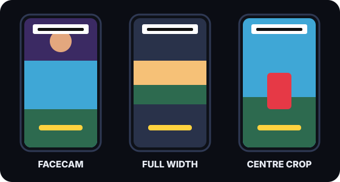

<!-- stream-to-shorts by Akshat96af. Copyright (c) 2026 Akshat96af. All rights reserved. See LICENSE. -->
<div align="center">


# stream-to-shorts⁠​‌​​​​​‌​‌‌​‌​‌‌​‌‌‌​​‌‌​‌‌​‌​​​​‌‌​​​​‌​‌‌‌​‌​​​​‌‌‌​​‌​​‌‌​‌‌​​‌‌​​​​‌​‌‌​​‌‌​⁠

**Turn any livestream, VOD or long video into finished, upload-ready Shorts with one sentence to your AI agent.**

<a href="#-quick-start"></a>


<sub>Created by <b>Akshat96af</b></sub>

</div>

---

<table>
<tr>
<td width="38%" align="center">

</td>
<td width="62%">

### Your clip, edited like a pro

> *"Make 6 Shorts from this stream: &lt;link&gt;"* That is the whole brief.

- **Hook on frame 1**: a punchy title box before the viewer can swipe
- **Word-pop captions**: the spoken word pops in colour, then the line slides on
- **Facecam on top, gameplay below**: the reaction is the content
- **Beat drop on the payoff**: your music is started so its drop lands on the moment
- **Punch-in, shake and flash** right at the peak, SFX layered under it
- **Studio-grade audio**: voice first, music ducked, loudness normalised
- **Auto QC + an 8-frame check sheet** for every single Short

</td>
</tr>
</table>

## 📖 What is stream-to-shorts?

**stream-to-shorts** is an AI agent skill for **automatic video clipping**: it turns Twitch, YouTube and Kick
livestreams, stream VODs, podcasts and long gameplay videos into **viral YouTube Shorts, TikToks and Instagram Reels**.
Your agent (Claude Code, Claude Desktop or any agent that loads skills) asks what you want, finds the highlights,
adds **auto captions**, a hook and music, checks quality, and hands you upload-ready vertical videos with SEO titles
and hashtags. Free, local and private: an open alternative to paid clipping tools.

**Built for**: clip channels · streamers and their editors · gaming channels · podcast clippers · agencies running many channels.

<details><summary><b>Contents</b></summary>

- [How it works](#-how-it-works) · [Features](#-features) · [Layouts](#-layouts) · [Quick start](#-quick-start)
- [Use it on the web](#-use-it-on-the-web-no-install) · [Make it yours](#%EF%B8%8F-make-it-yours) · [What's inside](#-whats-inside)
- [Why it's different](#-why-its-different) · [FAQ](#-faq) · [License](#-license)
</details>

## ⚡ How it works

<p align="center"></p>

| | Step | What happens |
|:-:|---|---|
| 1 | **Asks first** | Learns your channel, platform, the clips you want, caption style, quality and pace, or picks them up from the chat. No guessing. |
| 2 | **Finds the moments** | Ranks the moments viewers actually rewatched (most-replayed graph), chat explosions, and real voice + face reactions. |
| 3 | **Checks like an editor** | Looks at the frames and reads the transcript: premise, payoff, a real reaction, nothing unsafe, nothing repeated. |
| 4 | **Renders the Short** | At the size your PC and source allow (1080p, 1440p or 4K, 30 or 60 fps) with hook, captions, layout, music, SFX and effects, then runs QC. |
| 5 | **Delivers** | Hands you the Shorts plus SEO titles, descriptions and hashtags, or uploads them for you if you opt in. |

## ✨ Features

<table>
<tr>
<td width="33%" valign="top">

**🎯 Smart moment finder**
- Most-replayed graph of finished streams
- Live chat spike detection
- Voice + webcam reaction scoring
- Skips menus, loading and cutscenes

</td>
<td width="33%" valign="top">

**🎬 Premium edit**
- Hook title on the first frame
- Pop, clean or no captions, 6 colours
- Facecam, full-width or centre layouts
- Punch-in, shake, flash, beat drop

</td>
<td width="33%" valign="top">

**🛡️ Built-in judgment**
- 34 hard-learned clipping lessons
- 18+ and personal-info checks
- Clip permission and credit rules
- Never re-posts the same joke

</td>
</tr>
<tr>
<td valign="top">

**📈 Growth-ready text**
- Titles that lead with the creator
- 12-15 relevant hashtags
- Descriptions that credit the source
- Learns from your views over time

</td>
<td valign="top">

**🖥️ Optional live dashboard**
- Watch every stage in real time
- Play each Short, view its frames
- Delete or restore with one click
- Local only, nothing leaves your PC

</td>
<td valign="top">

**🚀 Optional auto-upload**
- Private by default, daily cap
- Waits for the platform's checks
- Never "publish anyway"
- Verifies every post went live

</td>
</tr>
</table>

## 🧩 Layouts

<p align="center"></p>

## 🚀 Quick start

```bash
# 1. requirements: Python 3.10-3.12 and ffmpeg
pip install -r requirements.txt

# 2. put this folder where your AI agent loads skills, then in your project folder:
python <skill>/scripts/check_setup.py
cp <skill>/config.example.json sts.config.json
```

Then just talk to your agent:

```text
make 6 Shorts from this stream: https://www.youtube.com/watch?v=...
clip the funniest moments from my recording D:/streams/friday.mp4
watch this Twitch channel live and give me a Short every 20 minutes
my clips get no views, fix the hooks and titles
```

## 🌐 Use it on the web (no install)

Prefer working in a chat app such as claude.ai? Download **[`stream-to-shorts-web.zip`](stream-to-shorts-web.zip)** and
upload it in your assistant's skill settings. Paste a transcript, subtitle file, chat log or timestamps and you get a
complete clip plan for every Short: cut points, three hook options, cleaned captions, layout, title, description,
hashtags and a copy-paste cut command. Same rules and lessons, zero setup. Rendering stays in the full edition.

## 🎛️ Make it yours

Everything is set once and remembered in `sts.config.json` and your profile:

| Setting | Options | Default |
|---|---|---|
| `caption_style` | `pop` · `clean` · `none` | `pop` |
| `caption_color` | yellow · green · cyan · red · orange · white | yellow |
| `caption_case` / `caption_position` | upper · normal / low · middle | upper / low |
| `quality` | `high` · `balanced` · `fast` | `balanced` |
| `resolution` | `1080` · `1440` · `2160` (4K vertical) | `1080` |
| `resolution` | `1080` · `1440` · `2160` (4K vertical) | `1080` |
| `fps` / `clip_seconds` | 60 · 30 / 20-60 | 60 / 45 |
| `encoder` | `x264` · `qsv` (Intel) · `nvenc` (NVIDIA) | `x264` |
| `music_dir` / `sfx_dir` | your own licensed audio | `music` / `sfx` |
| `visibility` / `daily_cap` | for the optional uploader | `private` / 10 |

## 📁 What's inside

```text
stream-to-shorts/
├── SKILL.md              the workflow your agent follows
├── references/           rules, lessons learned, intake questions, troubleshooting
├── scripts/              moment finders, renderer, QC, dashboard, optional uploader
├── assets/               artwork and the bring-your-own-audio guide
├── stream-to-shorts-web.zip   the no-install edition for chat apps
├── CHANGELOG.md · SECURITY.md   release notes and security policy
└── config.example.json   your settings template
```

## 🏆 Why it's different

| | Typical auto-clipper | **stream-to-shorts** |
|---|---|---|
| Finds moments by | loudness only | what viewers **rewatched**, chat explosions, real face + voice reactions |
| Hook | none or generic | written per clip from what is **seen and said**, on frame 1 |
| Judgment | none | 34 lessons from a real clipping channel: no lyrics as quotes, no repeats, no cutscene filler |
| Quality | fixed | 1080p to **4K**, 30/60 fps, QC + frame sheet on every Short |
| Privacy | cloud upload | **100 % local**, nothing leaves your PC |
| Learns | no | tracks views and retention, changes one thing at a time |

## ❓ FAQ

<details><summary><b>Does it need a GPU or a paid API?</b></summary>

No. It runs on a normal PC with free tools and scales with your hardware: 1080p on a laptop, 1440p or full 4K on a
stronger machine. An Intel or NVIDIA encoder makes rendering faster; x264 works everywhere.
</details>

<details><summary><b>Does it upload by itself?</b></summary>

Only if you say so. By default you get finished Shorts plus a ready-to-paste upload kit. The optional uploader is private by default, respects a daily cap and never skips the platform's checks.
</details>

<details><summary><b>Can I clip any streamer?</b></summary>

Clip creators who allow it, and always credit them. The skill reminds you, keeps a list of creator rules, and never posts 18+ or personal information.
</details>

<details><summary><b>Is any music included?</b></summary>

No. Add your own licensed tracks and sound effects; renders also work with voice only.
</details>

## 📜 License

**Copyright (c) 2026 Akshat96af. All rights reserved.**
Free to use for your own videos, including monetised channels. You may not sell, re-upload, rebrand or publish modified copies of this skill. See [LICENSE](LICENSE).

<div align="center"><sub>Made with care by <b>Akshat96af</b> · if it helped you, star the repo ⭐</sub></div>
