<!-- stream-to-shorts by Akshat96af. Copyright (c) 2026 Akshat96af. All rights reserved. See LICENSE. -->
<p align="center">
  
</p>

<p align="center">
  <a href="https://github.com/Akshat96af/stream-to-shorts/stargazers"></a>
  <a href="https://github.com/Akshat96af/stream-to-shorts/commits"></a>
  <a href="LICENSE"></a>
</p>

<p align="center">
  
  
  
  
  
  
  
  
</p>

# stream-to-shorts⁠​‌​​​​​‌​‌‌​‌​‌‌​‌‌‌​​‌‌​‌‌​‌​​​​‌‌​​​​‌​‌‌‌​‌​​​​‌‌‌​​‌​​‌‌​‌‌​​‌‌​​​​‌​‌‌​​‌‌​⁠

```bash
npx skills add Akshat96af/stream-to-shorts
```

Hand your agent a four-hour stream and get back Shorts people actually finish. stream-to-shorts finds the moments
viewers rewound, writes a hook for the first frame, cuts and captions the clip, checks every frame, and gives you
the title and hashtags to post it with. One sentence starts it: *"make 6 Shorts from this stream."*

<p align="center"></p>

| Included | Count | What you get |
|---|--:|---|
| Moment finders | 5 | Most-replayed graph, chat replay, live chat spikes, voice + webcam reactions, live audio spikes |
| Layouts | 3 | Facecam on top, full width or centre crop, rendered at 1080p, 1440p or 4K |
| Caption looks | 3 × 6 colours | Word-pop, clean or none, in upper or normal case, low or middle on screen |
| Lessons learned | 34 | Mistakes from a real clipping channel, written as rules the agent follows |
| Agent briefs | 3 | Editor, uploader and analyst roles for multi-agent runs |
| Safety tools | 4 | Content filter, 8-frame QC sheet, segment blur, privacy scanner |
| Optional extras | 2 | Live dashboard with play / delete / restore, and a YouTube Studio uploader |

## 📦 Install

| Where you use it | How to install |
|---|---|
| **Claude Code, Claude Desktop, Antigravity** | `npx skills add Akshat96af/stream-to-shorts` |
| **claude.ai and other chat apps** (plans clips from transcripts, nothing to install) | download [`stream-to-shorts-web.zip`](stream-to-shorts-web.zip) and upload it in your skill settings |
| **Manual** | download the latest release and unzip it into your agent's skills folder |

## ▶️ Start using it

The first time, the skill asks a few short questions: your channel, the clips you want, the caption look, the quality.
It remembers the answers, so later sessions start straight away.

| What you want | Say this |
|---|---|
| Shorts from a finished stream | *"Make 6 Shorts from this stream: &lt;link&gt;"* |
| Shorts from your own recording | *"Clip the funniest moments from D:/streams/friday.mp4"* |
| A Short every 20 minutes from a live stream | *"Watch &lt;channel&gt; live and give me a Short every 20 minutes"* |
| Better hooks and titles | *"My Shorts get no views, rewrite the hooks and titles"* |
| Shorts in 4K | *"Render these in 4K at 60 fps"* |
| Watch the work live | *"Open the dashboard"* |
| Post them for you | *"Upload them to my channel, private, max 5 a day"* |

<table>
<tr>
<td width="40%" align="center"></td>
<td width="60%">

### What every Short gets

- A hook on the first frame, written from what is on screen and what is said
- Word-pop captions that follow the voice, with misheard lyrics and stuck repeats removed
- The streamer's camera on top and the gameplay below whenever there is a webcam
- Your music, started so its drop lands on the payoff
- A punch-in, a shake and a flash on the peak, with the voice kept above the music
- Automatic QC for loudness, peaks, black frames and silence, plus an 8-frame check sheet
- A title, a description and 12-15 hashtags that credit the creator

</td>
</tr>
</table>

## ⚡ How it works

| | Step | What happens |
|:-:|---|---|
| 1 | **Ask** | Learns your channel, platform, the clips you want, captions, quality and pace, or reads them from the chat. |
| 2 | **Find** | Ranks what viewers rewatched, where chat exploded, and where the streamer's face and voice reacted. |
| 3 | **Check** | Looks at the frames and reads the transcript: is there a setup, a payoff and a real reaction, and is it safe to post? |
| 4 | **Render** | Builds the Short at the size your PC and source allow, with hook, captions, layout, music, SFX and effects. |
| 5 | **QC** | Measures loudness, peaks, black frames and silence, then shows you 8 frames from the finished Short. |
| 6 | **Deliver** | Hands you the Shorts and an upload kit, or uploads them for you if you asked it to. |
| 7 | **Learn** | Compares views and retention by hook, layout and length, and changes one thing at a time. |

<details>
<summary><strong>Layouts</strong></summary>

<p align="center"></p>
</details>

<details>
<summary><strong>Settings you can change by asking</strong></summary>

| Setting | Options | Default |
|---|---|---|
| Output size | 1080p · 1440p · 4K (2160x3840) | 1080p |
| Frame rate / length | 60 · 30 fps / 20-60 s | 60 fps / 45 s |
| Quality | high · balanced · fast | balanced |
| Captions | pop · clean · none; 6 colours; upper/normal; low/middle | pop, yellow, upper, low |
| Content filter | strict · standard · off | strict |
| Music / SFX | your own licensed audio, or voice only | voice only until you add audio |
| Uploads (optional) | private / public, daily cap | private, 10 |
</details>

## 🏆 Why choose stream-to-shorts?

| Without it | With stream-to-shorts |
|---|---|
| Clips picked by volume, full of cutscenes and menus | Moments viewers rewatched, with a real reaction and a payoff |
| "You won't believe this" hooks on every clip | A hook written for each clip from what is seen and said |
| Captions that quote song lyrics or stutter on one word | Lyrics and loops filtered out, captions read before render |
| The same beginner mistakes on every new channel | 34 rules learned the hard way, applied every time |
| One fixed resolution | 1080p to 4K, matched to your PC and your source |
| Your footage uploaded to someone's cloud | Everything runs on your PC |
| No idea why a Short flopped | Views and retention compared by hook, layout and length |

## 📁 What's inside

<table>
<tr>
<td width="33%" valign="top">

**🧠 SKILL.md**<br/>
<sub>The workflow your agent follows, from the first question to the posted Short.</sub>

</td>
<td width="33%" valign="top">

**📚 references/**<br/>
<sub>Editorial rules, the 34 lessons, intake questions, rendering and upload guides, agent briefs, troubleshooting.</sub>

</td>
<td width="33%" valign="top">

**🎬 scripts/**<br/>
<sub>Moment finders, the renderer, QC, the dashboard, the privacy scanner and the optional uploader.</sub>

</td>
</tr>
<tr>
<td valign="top">

**🌐 stream-to-shorts-web.zip**<br/>
<sub>The no-install edition for claude.ai and other chat apps.</sub>

</td>
<td valign="top">

**🎨 assets/**<br/>
<sub>The artwork in this page and the guide to adding your own music and SFX.</sub>

</td>
<td valign="top">

**⚙️ config.example.json**<br/>
<sub>Every setting with its default, for anyone who prefers files to asking.</sub>

</td>
</tr>
</table>

<details>
<summary><strong>Every script, one line each</strong></summary>

| Script | What it does |
|---|---|
| `vod.py` | Finished streams: most-replayed graph, chat replay and loudness, then cuts the top moments at full quality |
| `scan.py` | Ranks a long recording in about 90 seconds per 2 hours without cutting anything |
| `moments.py` | Finds voice + webcam-motion moments in a recording, cuts and transcribes them |
| `clipwatcher.py` | Records a live stream and cuts when chat spikes |
| `audiowatch.py` | Live streams whose chat you cannot read: cuts on loud reactions |
| `cut.py` | Cuts one moment from any file or timestamp |
| `finalize.py` | The renderer: layout, captions, hook, music, SFX, effects and QC |
| `blur_segment.py` | Saves a good clip by blurring one stretch of it |
| `music.py` | Starts each track so its drop lands on the moment |
| `check_setup.py` | First-run check for ffmpeg, Python and the speech model |
| `privacy_scan.py` | Finds personal data before you share a folder |
| `dash.py` · `status.*` | The optional local dashboard |
| `uploader/` | The optional YouTube Studio uploader |
</details>

## 🔒 Security and privacy

- It runs on your computer. There are no accounts and no telemetry, and nothing is uploaded unless you turn the uploader on.
- The dashboard only listens on `127.0.0.1`. The uploader uses your own signed-in browser and never sees a password.
- `privacy_scan.py` checks a folder for e-mail addresses, channel ids, keys and your name before you share it.
- The only official copy lives at [github.com/Akshat96af/stream-to-shorts](https://github.com/Akshat96af/stream-to-shorts). Report a vulnerability privately through [SECURITY.md](SECURITY.md).

## ❓ FAQ

<details><summary><b>Does it need a GPU, a paid API or a powerful PC?</b></summary>

No. It runs on free tools and scales with your hardware: 1080p on a laptop, 1440p or 4K on a stronger machine. An
Intel or NVIDIA encoder makes rendering faster.
</details>

<details><summary><b>Which agents does it work with?</b></summary>

Claude Code and Claude Desktop run the full edition. claude.ai and other chat apps use the web edition, which plans
clips from transcripts and timestamps.
</details>

<details><summary><b>Does it upload by itself?</b></summary>

Only if you ask. By default you get the Shorts and an upload kit. The uploader keeps videos private unless you say
otherwise, stays under a daily cap, waits for the platform's checks, and never clicks "publish anyway".
</details>

<details><summary><b>Can I clip any streamer?</b></summary>

Clip creators who allow it, and credit them. The skill keeps a list of creator rules and puts the credit and source
link in every description.
</details>

<details><summary><b>Is music included?</b></summary>

No. Add your own licensed tracks and sound effects. Shorts also work with just the streamer's voice.
</details>

<details><summary><b>Something went wrong</b></summary>

Tell your agent what happened; the skill ships with a troubleshooting guide. You can also open an
[issue](https://github.com/Akshat96af/stream-to-shorts/issues/new/choose).
</details>

## 🧭 Background

I built stream-to-shorts while running a clipping channel: recording streams, cutting moments, editing and posting
Shorts around the clock. Every rule in it comes from a mistake I made once, like quoting a song on the radio as if the
streamer had said it, or publishing before the platform finished its copyright check.

Release notes: [CHANGELOG.md](CHANGELOG.md).

## 📜 License

**Copyright (c) 2026 Akshat96af. All rights reserved.** Free to use for your own videos, including monetised
channels. You may not sell, re-upload, rebrand or publish modified copies of this skill. See [LICENSE](LICENSE).

<p align="center"><b>If stream-to-shorts saves you hours, star the repo ⭐</b><br/><sub>Made by <b>Akshat96af</b></sub></p>
